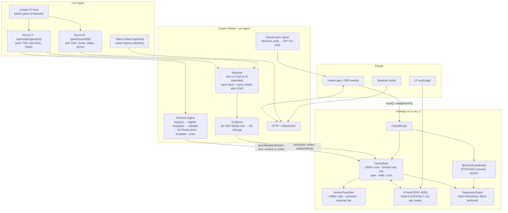

# Architecture

## Market lifecycle

| Phase | Time | Enforced by |
|---|---|---|
| Open | engine spots a moment; `openMarket` commits rule hash, lock, window, opening price; vault funds the worst case | `ClutchHook.openMarket`: uncertainty band, one live market per stream, Normal sequencer |
| Trading | now < lock (about 18 s) | `beforeSwap`: trusted router, market open, before lock, Normal sequencer, gate admits the human |
| Buffer | lock → lock + stream latency (8 s native board; 1.5× p95 viewer delay for Twitch) | `windowStart ≥ lockTime + latencyBuffer` or `openMarket` reverts |
| Window | the game plays; both sources record | the engine records first-observed time per ply |
| Resolve | as soon as both sources give a final evaluation, or VOID 45 s after window end | `resolve`: not before window start; Blackout overlap forces VOID |
| Settled / void | winners `claim` 1 USDC per share; VOID refunds cost incl. fees | `claim`, `expire` (anyone, 1 h after window end) |

## Money flow per market

- Stake `x` → fee `2%·x` (held until resolution) + `0.98·x` into the LMSR curve.
- Resolution (YES/NO): winners are paid from the pot (`collected + subsidy`). Leftover plus 50% of fees goes to the vault;
  25% of fees to the streamer, 12.5% to the resolver agent, 12.5% to the protocol.
- VOID: every trader is refunded their full cost; the subsidy returns to the vault untouched.
- Solvency: `collected + subsidy ≥ winning shares` for any trade sequence (proof in `LMSR.sol`, fuzzed in
  `testFuzz_solvency`). Fills round down by 1e−6 shares so fixed-point error always favours the pot.

## Why these boundaries

- **The rule decides, not the model.** The AI only selects a template and a price. `evaluate()` is deterministic
  code over facts both sources emit, so a dispute can only be "the data was wrong", and the evidence bundle is public.
- **The hook holds the money and the rules.** Everything integrity-critical (forward window, caps, exclusion,
  streamer bar, blackout void, solvency) is enforced onchain; the app only explains refusals.
- **One SequencerGuard per chain.** Sequencer state is chain-level, so every hook that cares reads the same anchor.
